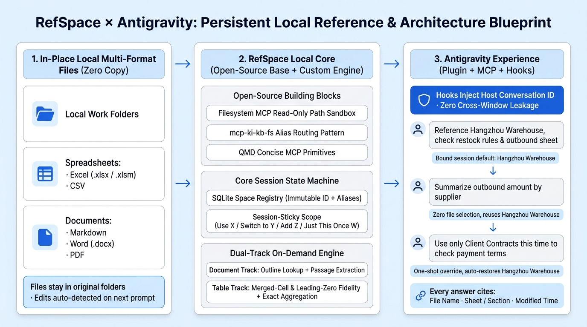
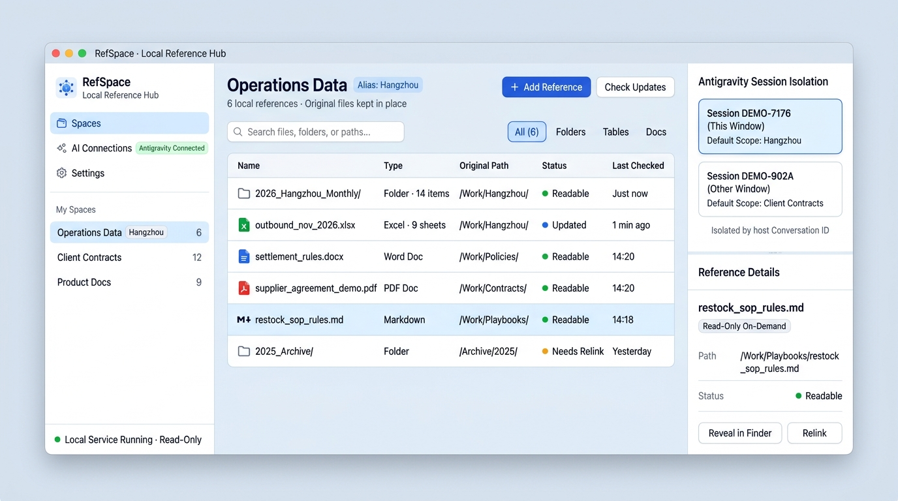
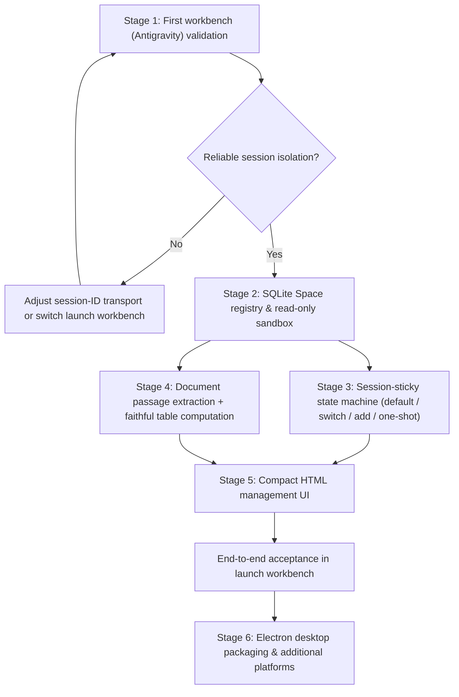

<div align="center">

# RefSpace · 引知

**Register local folders, spreadsheets, and documents once, then keep using them by name in your AI workbench.**

[How sticky references work](#how-sticky-references-work) · [One-sentence scope control](#one-sentence-scope-control) · [Multi-format reading rules](#how-folders-documents-and-tables-are-read) · [Open-source landscape](#open-source-landscape) · [Development status](#development-status) · [Data & integration boundaries](#data-privacy-and-integration-boundaries)

[简体中文](README.md) · **English**

</div>

[](docs/images/refspace-overview-en.jpg)

*Concept diagram generated by AI using fictional file names for the planned 0.1 design; not a screenshot of an accepted release. Version 0.1 is in internal development.*

Opening a new chat or switching windows usually means hunting through local folders and uploading the same spreadsheets and notes again. **RefSpace (引知)** does not add another chat box or import full copies into a web page: your files stay in their original locations on disk while a local service manages named **Spaces**, tracks each conversation's active scope, and reads only what the current task requires.

Version 0.1 validates local tool invocation and multi-window session isolation in **Antigravity** first, before completing the local management UI and desktop installer.

<details>
<summary>View the local management UI concept</summary>



*AI-generated UI concept using fictional paths and session IDs to align space navigation, multi-format source statuses, and the on-demand detail drawer; not a screenshot of a shipped client.*

</details>

## How sticky references work

All directories, file names, session IDs, and prompts below are fictional examples constructed to illustrate the 0.1 rules rather than real business records or test evidence.

Suppose two Spaces are registered on your computer:

| Space | Alias | Stable ID | Local path (fictional) | Files included |
| --- | --- | --- | --- | --- |
| Operations Data | `Hangzhou` | `sp_01` | `/Work/Hangzhou/` | `outbound_nov_2026.xlsx`, `restock_sop_rules.md`, `settlement_rules.docx` |
| Client Contracts | `Contracts` | `sp_02` | `/Work/Contracts/` | `supplier_agreement_demo.pdf` |

When two Antigravity windows are open at the same time, each conversation retains its own reference scope:

| Window & turn | User prompt | What is read or calculated | Provenance returned | Default scope after turn |
| --- | --- | --- | --- | --- |
| `DEMO-7176` · Turn 1 | Reference `Hangzhou`, check restock rules and outbound details | Binds `sp_01`; extracts relevant sections of `restock_sop_rules.md` and computes valid ranges in `outbound_nov_2026.xlsx` | `restock_sop_rules.md`, `outbound_nov_2026.xlsx · Outbound`, file mtime | `Hangzhou` |
| `DEMO-7176` · Turn 2 | Summarize outbound amount by supplier | Reuses `sp_01` automatically without re-selecting files or repeating the Space name | `outbound_nov_2026.xlsx · Outbound`, file mtime | `Hangzhou` |
| `DEMO-7176` · Turn 3 | Use only `Contracts` this time to check payment terms | Reads `supplier_agreement_demo.pdf` from `sp_02` for this turn only | `supplier_agreement_demo.pdf · Payment Terms`, file mtime | Restores `Hangzhou` |
| `DEMO-902A` · Concurrent | Check breach clauses in the framework agreement | Reads `sp_02` bound to `DEMO-902A` | `supplier_agreement_demo.pdf`, file mtime | `Contracts` (unaffected by `DEMO-7176`) |

If you edit and save `outbound_nov_2026.xlsx` in Excel after Turn 2, the next task checks the file's modification time and reads the updated version. Within a single task, one consistent snapshot is used; if a file is moved or loses read permission, the affected source is reported explicitly rather than silently returning stale results.

## One-sentence scope control

A Space only needs to be linked to local files or folders once. Inside a connected AI workbench, explicit reference instructions update the active scope:

| User expression | Current turn | Subsequent session default |
| --- | --- | --- |
| `Reference Hangzhou` | Binds the registered Space to this session | `Hangzhou` |
| `Analyze monthly sales and inventory changes` | Reuses the current scope and locates relevant files | Unchanged |
| `Switch to Client Contracts` | Replaces the current session scope | `Client Contracts` |
| `Also add Inventory Data` | Keeps existing Spaces and adds `Inventory Data` | `Existing + Inventory Data` |
| `Remove Inventory Data` | Removes that Space from the current session | Remaining Spaces kept |
| `Use only Client Contracts this time` | Uses `Client Contracts` for this task only | Previous default preserved |
| `Clear all references` | Clears the session's active scope | None |

Four safeguards prevent accidental switching or cross-session leakage:

- **Explicit reference intent required**: Mentioning a Space name casually in discussion does not alter the active scope.
- **Atomic fallback on ambiguity or error**: Unregistered names prompt creation; ambiguous names, unreadable sources, or canceled actions leave the previous scope intact.
- **Stable ID decoupled from display names**: Spaces are tracked by immutable internal IDs (`sp_01`), so renaming a Space or re-linking a moved folder preserves existing bindings.
- **Host-backed session restoration**: Reopening an earlier conversation restores its scope only when the host workbench supplies a reliable session identifier; new conversations start unbound rather than inheriting a silent global default.

## How folders, documents, and tables are read

Binding a Space grants **permission to search and read within that boundary**—it does not dump an entire folder into the model prompt on every turn:

| Source category | Planned formats | On-demand handling |
| --- | --- | --- |
| Folders & multi-path | Single or multiple local directories and standalone files | Enforces read-only allowlists via `realpath`, detects added/modified files, skips hidden and temporary files |
| Documents | `.md`, `.txt`, `.docx`, `.pdf`, `.json` | Inspects heading/outline structure, extracts relevant passages on demand, and cites file name plus section or page |
| Spreadsheets | `.xlsx`, `.xlsm`, `.csv` | Detects worksheets, independent regions, and column types; runs full-range filtering, deduplication, and aggregation deterministically |

Spreadsheet processing preserves verified data-fidelity rules:

- Detects actual non-empty cell bounds, skipping million-row formatting ghosts and separating side-by-side detail and summary regions.
- Expands merged cells from their top-left value across covered ranges while keeping genuine blanks empty.
- Preserves leading zeros and long identifiers (order IDs, SKUs, barcodes) as text; treats numeric `0` and boolean `false` as valid values.
- Never guesses uncached Excel formula results; missing formula caches trigger an explicit warning so the workbook can be saved in Excel and re-read.

## What stays on disk vs. local SQLite

| Stored in local SQLite | Original files & exported outputs |
| --- | --- |
| Immutable Space IDs, names, and aliases | Original files remain untouched in their native directories; no full copies stored in HTML or SQLite |
| Local file/folder references, read status, and check timestamps | Read on demand in read-only mode during task execution |
| Lightweight directory listings, sheet/header summaries, and mtimes | Parsed content is held only transiently for the active task |
| Per-workbench, per-session Space bindings | Exported summary sheets, charts, or reports are saved separately when requested |
| Minimal task provenance records (file, sheet/section, version timestamp) | Used to verify answers without cluttering the main UI with permanent banners |

## Open-source landscape

Existing local-file MCP servers and knowledge-base tools were reviewed prior to implementation. Several provide useful building blocks, while leaving open the end-to-end combination of in-place multi-format files, named Spaces, session-sticky scope switching, and deterministic spreadsheet calculation:

| Project | Reusable strengths | Gap relative to RefSpace |
| --- | --- | --- |
| [`@modelcontextprotocol/server-filesystem`](https://github.com/modelcontextprotocol/servers/tree/main/src/filesystem) | Directory allowlists, `realpath` validation, and read-only file access | Operates on raw paths; no named Spaces, session-sticky state machine, management UI, or spreadsheet aggregation |
| [`mcp-ki-kb-fs`](https://github.com/knowledgeislands/mcp-ki-kb-fs) | Maps aliases to local directories in read-only mode | Requires passing the alias on every call; lacks persistent session defaults and one-shot overrides |
| [`tobi/qmd`](https://github.com/tobi/qmd) | Named directory collections, `stdio`/HTTP MCP transports, and concise retrieval primitives | Focused on indexed Markdown/notes rather than zero-copy in-place Excel/CSV computation |
| [`localmd`](https://github.com/whitefoxx/localmd) | Clean local-folder browsing, provenance UI, and browser-extension bridging patterns | Centers on its own built-in chat workspace; pure browser directory handles depend on browser permission persistence |
| [`AnythingLLM`](https://github.com/Mintplex-Labs/anything-llm) | Desktop background lifecycle and multi-format document extraction patterns | Built around document ingestion and an internal chat client rather than a lightweight external reference hub |

Notes above reflect repository and documentation review; licenses, maintenance status, and runtime behavior will be re-verified before adopting any dependency.

## Development status

RefSpace is in **0.1 internal development**. The Python stdlib local core, Antigravity plugin bundle (`MCP + Hooks + Rules`), multi-format dual-track engine, and compact HTML management console are implemented and verified by automated checks; live two-window pilot runs on real user workbooks and Electron desktop packaging remain in upcoming acceptance stages.



| Stage & scope | What you can verify today |
| --- | --- |
| 1. First workbench validation | [Antigravity plugin bundle](plugins/refspace/) (`Stdio / HTTP MCP` + `PreInvocation / PreToolUse / Stop` hooks) implemented. Automated tests verify host `conversationId` enforcement, two-window isolation, and automatic `once` rollback; interactive pilot runs are next. |
| 2. Space registry & read-only sandbox | SQLite WAL registry and `realpath` read-only sandbox implemented. Verified stable IDs across renames, symlink escape blocking, `needs_relink` detection, and path relinking. |
| 3. Session-sticky state machine | All seven scope transitions implemented and tested, including ambiguity/unreadable rollback and prompt-injection isolation from file text. |
| 4. Multi-format & spreadsheet engine | `.md`/`.txt`/`.docx`/`.pdf`/`.json` passage extraction and `.xlsx`/`.xlsm`/`.csv` sparse parsing implemented (skipping million-row ghosts, separating side-by-side regions, expanding merged cells, preserving leading zeros/`0`/`false`, flagging uncached formulas, deduplicated aggregation, and live reload after edits). |
| 5. Compact HTML management UI | Light-mode management console (`src/refspace/ui/`) implemented with Space management, native macOS Finder pickers, on-demand structure drawer, and independent live health checks. |
| 6. Desktop packaging & expansion | Pending. Package with Electron for double-click startup and validate additional AI workbenches individually. |

## Developer quick start

RefSpace uses only the **Python 3.9+ standard library** (`sqlite3`, `zipfile`, `xml.etree`, `http.server`) with zero third-party `npm` or `pip` packages required.

Run syntax compilation and the full automated verification suite from the repository root:

```sh
bash scripts/check.sh
```

To try the local management console and demo Spaces with generated fictional files (stored under Git-ignored `.refspace/`):

```sh
# 1. Generate fictional multi-format fixtures (.xlsx / .docx / .pdf / .md / .csv) and seed demo Spaces
PYTHONPATH=src REFSPACE_DB_PATH=.refspace/demo.db python3 -m refspace seed-demo

# 2. Start the local management UI (http://127.0.0.1:17890, also serving Streamable HTTP /mcp)
PYTHONPATH=src REFSPACE_DB_PATH=.refspace/demo.db python3 -m refspace serve
```

Opening this repository in Antigravity discovers `plugins/refspace` automatically via `.agents/plugins.json`. To install the plugin globally across all workspaces on your machine, run `PYTHONPATH=src python3 -m refspace install-plugin`.

[Automated checks](.github/workflows/check.yml) · [Plugin manifest](plugins/refspace/plugin.json) · [Session rules](plugins/refspace/rules/AGENTS.md) · [Verification suite](tests/run_all_tests.py)

## Data, privacy, and integration boundaries

- **"No local copy" is distinct from "fully offline inference"**: RefSpace stores only references and metadata locally, but when your connected AI workbench uses a cloud model, relevant excerpts, headers, or computed results required to answer your prompt are transmitted by that workbench to its model provider.
- **File contents never act as control instructions**: Text inside documents and cells is treated strictly as data and cannot switch Spaces or expand directory permissions.
- **Platform support is verified one workbench at a time**: Supporting MCP or a model's API does not automatically connect web chat products (such as Doubao or Qwen web). Only platforms that pass live file-reading and session-isolation checks are marked as supported.
- **Public repository hygiene**: This repository never stores real business spreadsheets, personal documents, personal machine paths, SQLite databases (`*.db` / `*.sqlite*`), or credentials.
