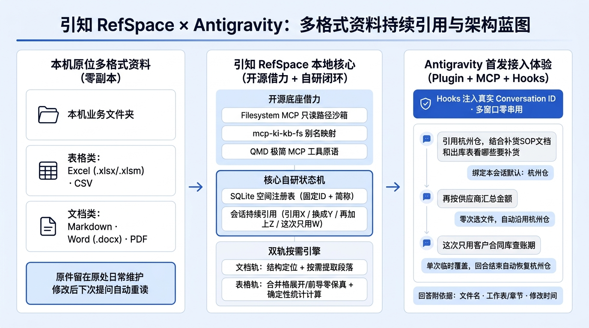
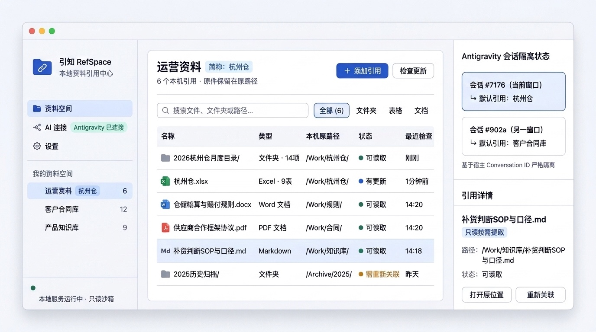
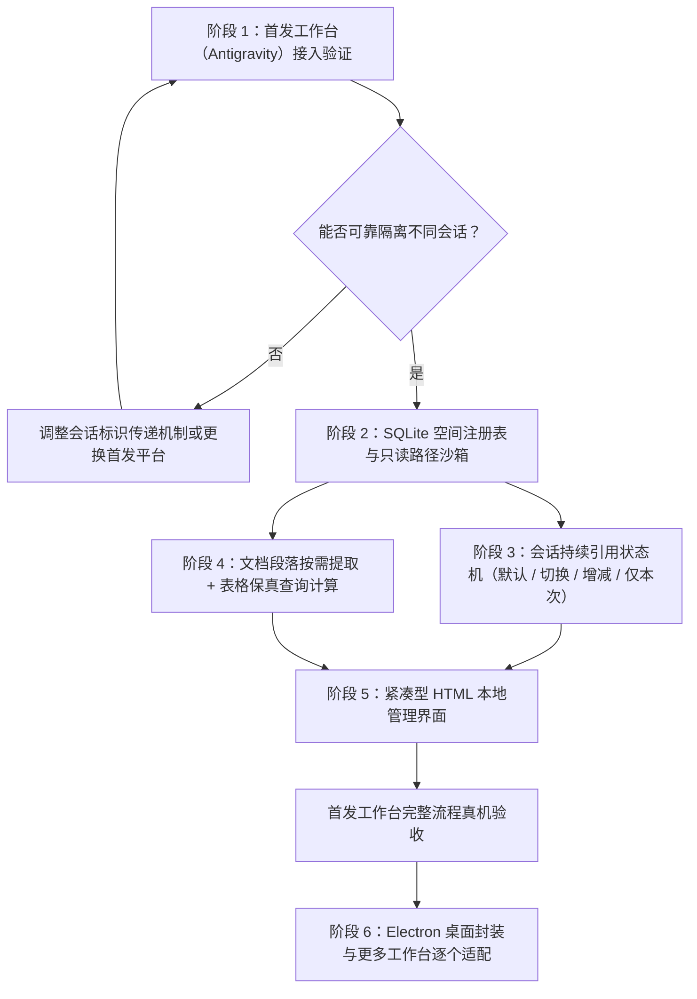

<div align="center">

# 引知 RefSpace

**把电脑里的文件夹、表格和文档登记一次，在常用的 AI 工作台里按名字持续使用。**

[一次引用怎样生效](#一次引用怎样持续生效) · [一句话调整范围](#一句话调整资料范围) · [多格式读取规则](#文件夹文档与表格怎样读取) · [开源方案对照](#相关开源方案对照) · [当前进度](#当前进度与验证范围) · [数据与接入边界](#数据隐私与接入边界)

**简体中文** · [English](README.en.md)

</div>

[](docs/images/refspace-overview-zh.jpg)

*上图为首版架构与交互示意图，由 AI 生成并使用虚构资料名称，并非实际产品界面或实测截图。项目目前处于 0.1 内部开发阶段。*

每次新开对话或换一个任务窗口，重新翻找本地目录、上传表格和说明文档都会打断手头的工作。**引知 RefSpace** 不另建聊天界面，也不要求先把文件导入网页存成副本：原文件留在电脑原来的位置继续维护，本机服务负责登记「资料空间」、记住每个会话正在使用的范围，并在已接入的 AI 工作台提问时按需读取相关内容。

首版优先在 **Antigravity** 工作台中验证本机工具调用与多窗口会话隔离，跑通完整引用链路后再完成本地管理界面与桌面安装包。

<details>
<summary>查看本地管理界面概念图</summary>



*管理界面概念图（AI 生成，含虚构路径与会话编号），用于对齐空间列表、多格式来源状态与按需详情抽屉，不代表已完成客户端截图。*

</details>

## 一次引用怎样持续生效

下面的目录、文件名、会话编号与对话均为说明首版规则构造的虚构示例，不来自真实业务资料，也不计入测试证据。

假设在本机登记了两个资料空间：

| 资料空间 | 简称 | 固定编号 | 本机位置（虚构） | 包含资料 |
| --- | --- | --- | --- | --- |
| 运营资料 | `杭州仓` | `sp_01` | `/Work/杭州仓/` | `11月出库明细.xlsx`、`补货判断规则.md`、`仓储结算说明.docx` |
| 客户合同库 | `合同库` | `sp_02` | `/Work/合同/` | `供应商框架协议_示例.pdf` |

同时打开两个 Antigravity 对话窗口时，引用状态按各自会话独立保存：

| 所在窗口 | 用户输入 | 本次读取与计算 | 附带的来源依据 | 回合结束后的会话默认 |
| --- | --- | --- | --- | --- |
| `DEMO-7176` · 第 1 轮 | 引用杭州仓，结合补货规则和出库明细看哪些商品需要补货 | 绑定 `sp_01`；提取 `补货判断规则.md` 对应段落，统计 `11月出库明细.xlsx` 有效数据区 | `补货判断规则.md`、`11月出库明细.xlsx · 出库明细` 及文件修改时间 | `杭州仓` |
| `DEMO-7176` · 第 2 轮 | 再按供应商汇总出库金额 | 沿用 `sp_01`，无需再次选文件夹或点名空间 | `11月出库明细.xlsx · 出库明细` 及文件修改时间 | `杭州仓` |
| `DEMO-7176` · 第 3 轮 | 这次只用合同库核对结算账期 | 仅本轮读取 `sp_02` 下的 `供应商框架协议_示例.pdf` | `供应商框架协议_示例.pdf · 结算条款` 及文件修改时间 | 仍保持 `杭州仓` |
| `DEMO-902A` · 同期进行 | 核对框架协议里的违约责任 | 读取该窗口已绑定的 `sp_02` | `供应商框架协议_示例.pdf` 及文件修改时间 | `合同库`（不受 `DEMO-7176` 影响） |

如果第 2 轮之后你在 Excel 中修改并保存了 `11月出库明细.xlsx`，下一次提问前会先检查文件修改时间并读取更新后的内容。同一次分析任务内保持同一文件版本；若原文件被移走或失去读取权限，会明确指出受影响的来源，不会把旧结果当作最新数据返回。

## 一句话调整资料范围

资料空间只需在初次使用时关联本机文件或文件夹。后续在已接入的 AI 会话中，通过明确指令改变范围：

| 用户表达 | 本次任务处理 | 后续会话默认 |
| --- | --- | --- |
| `引用杭州仓` | 将已登记的「杭州仓」绑定到当前会话 | `杭州仓` |
| `分析本月销售与库存变化` | 沿用当前会话范围并定位相关资料 | 不变 |
| `换成客户合同库` | 替换当前会话的引用范围 | `客户合同库` |
| `再加上库存资料` | 保留原范围并加入「库存资料」 | `原空间 + 库存资料` |
| `取消库存资料` | 从当前会话移除该空间 | 其余已引用空间保留 |
| `这次只用客户合同库` | 仅本次任务使用「客户合同库」 | 原默认范围不变 |
| `取消全部引用` | 清空当前会话的引用范围 | 无默认引用 |

为避免误切或串用，状态流转遵循四条约束：

- **明确的引用意图才触发变更**：正常讨论中顺带提到“客户合同库”几个字，不会改动当前范围。
- **失败或歧义时保留原范围**：说出尚未建立的空间名时才引导关联来源；名称重名有歧义、来源不可读或中途取消时，原会话默认范围保持不变。
- **固定编号与名称解耦**：空间依赖内部固定编号（如 `sp_01`）维持关联，修改空间名称或简称不会中断已有会话；文件夹移动位置后重新关联一次，引用该来源的空间即可继续使用。
- **会话恢复需宿主支持**：重新打开历史会话时，仅在接入工作台能够提供稳定会话标识的前提下恢复原范围；新会话首次调用需明确指定空间，不用全局默认值静默代替逐会话记忆。

## 文件夹、文档与表格怎样读取

默认引用一个资料空间，表示**允许在这个范围内检索和读取资料**，不代表每次提问都把整个文件夹塞进模型上下文。本机服务先扫描目录与结构摘要，再按资料类型分轨处理：

| 资料类型 | 支持范围（规划） | 按需处理方式 |
| --- | --- | --- |
| 文件夹与多路径 | 本机单个或多个目录、独立文件 | 校验只读白名单路径，对比修改时间发现新增或变更文件，过滤隐藏与临时文件 |
| 文档资料 | `.md`、`.txt`、`.docx`、`.pdf`、`.json` | 读取标题层级与目录结构，按问题定位相关章节或段落片段，附带文件名与章节／页码依据 |
| 表格资料 | `.xlsx`、`.xlsm`、`.csv` | 识别工作表、独立数据区域与字段类型，在确定范围内完整执行筛选、去重计数与分组汇总，不拿少量切片推测总体数字 |

表格读取延续已验证的数据保真规则：

- 按实际非空单元格识别范围，跳过纯格式形成的百万级空白行，区分同页并排的明细区与汇总区。
- 合并单元格在读取时将左上角值展开到所覆盖区域，同时保留源表中的真实空白。
- 订单号、SKU、条码等编号保留前导零与长数字，不转成科学计数法；数值 `0` 和布尔值 `false` 均作为有效值保留。
- 不自行猜算缺失的 Excel 公式结果；当公式单元格缺少缓存值时，明确返回数据提示，由用户回原表保存计算结果后重读。

## 本机保存什么与原件关系

| 本地 SQLite 保存的记录 | 原文件与任务产物的处理 |
| --- | --- |
| 资料空间固定编号、显示名称与简称 | 原文件始终留在电脑原位置，不复制整份副本进网页或数据库 |
| 本机文件／文件夹路径引用、可读状态与最近检查时间 | 任务执行时按需只读读取，不修改或回写源表格与源文档 |
| 轻量目录清单、工作表／表头结构摘要与更新时间 | 解析内容仅作为完成当前任务的临时数据 |
| 各工作台会话与资料空间的绑定关系 | 需要导出的汇总表、图表或分析文档作为独立成果另行保存 |
| 最小必要的任务来源记录（文件、工作表／章节、版本时间） | 用于核对回答依据，不在管理界面常驻堆叠大段说明 |

## 相关开源方案对照

启动开发前已核查同类本地文件接入与知识库开源项目。现有项目可提供底层路径防护与协议参考，但尚未覆盖“原位多格式资料＋命名空间＋跨窗口持续默认与一句话切换＋表格确定性计算”的完整组合：

| 项目 | 可借鉴的现有能力 | 与本项目目标的差异 |
| --- | --- | --- |
| [`@modelcontextprotocol/server-filesystem`](https://github.com/modelcontextprotocol/servers/tree/main/src/filesystem) | 目录白名单限制、`realpath` 路径校验与只读文件访问 | 直接面向物理路径；不含资料空间命名、会话默认状态机、管理界面及复杂表格计算 |
| [`mcp-ki-kb-fs`](https://github.com/knowledgeislands/mcp-ki-kb-fs) | 用“别名 → 本机目录”映射多个本地知识库，默认只读 | 每次调用仍需显式传入知识库别名，不具备会话持续默认与单次临时覆盖规则，目录结构约定较固定 |
| [`tobi/qmd`](https://github.com/tobi/qmd) | 将目录注册为命名集合，提供 `stdio`／`HTTP` 双模式 MCP 与收敛的检索原语 | 主要面向 Markdown 等文本并建立本地内容索引，不直接承担原位 Excel／CSV 的精确聚合统计 |
| [`localmd`](https://github.com/whitefoxx/localmd) | 浏览器直接挂载本机目录的轻量资料浏览与来源定位，配套浏览器扩展桥接思路 | 对话主要发生在其自有界面内；纯浏览器目录句柄的跨重启权限依赖浏览器状态 |
| [`AnythingLLM`](https://github.com/Mintplex-Labs/anything-llm) | 桌面端本地服务组织、多工作区管理与文档抽取经验 | 围绕导入建库与内置聊天设计，体量较重，不同于低频维护的轻量引用中心 |

以上对照基于公开仓库与文档整理，尚未在全部目标环境安装实测；正式引入任何第三方组件前，将逐项核对许可证、维护状态与安全边界。

## 当前进度与验证范围

项目当前处于 **0.1 内部开发阶段**。本机核心服务、Antigravity 插件束（`MCP + Hooks + Rules`）、多格式按需读取引擎与本地 HTML 管理端已完成首版代码实现并通过自动化回归检查；真实业务文件的双窗口人工试跑与 Electron 桌面安装包仍在后续验收范围。



| 阶段与范围 | 现在能验证什么 |
| --- | --- |
| ① 首发工作台接入验证 | 已提供 [Antigravity 插件束](plugins/refspace/)（含 `Stdio / HTTP MCP` 与 `PreInvocation / PreToolUse / Stop` 钩子）。自动化测试已验证宿主 `conversationId` 强制覆写、双窗口并发隔离及 `这次只用` 回合结束自动恢复；待完成真实对话窗口人工试跑。 |
| ② 本地引用核心与沙箱 | 已实现 SQLite WAL 注册表与 `realpath` 只读白名单沙箱。已验证固定空间编号改名保留、跨目录软链接拦截、文件夹移走标记 `needs_relink` 及重新关联恢复。 |
| ③ 会话持续引用服务 | 已实现绑定、沿用、替换、追加、移除、清空与“仅本次使用”七类流转，已验证重名歧义／来源不可读时保留原范围，以及文档内指令文本防注入。 |
| ④ 多格式读取与表格计算 | 已实现 `.md`／`.txt`／`.docx`／`.pdf`／`.json` 章节提取，以及 `.xlsx`／`.xlsm`／`.csv` 稀疏解析（跳过百万空格式行、同页多区域分离、合并格展开、分段前导零与长编号保真、`0`/`false` 保留、未缓存公式提示、拆箱去重聚合与原件修改后即时重读）。 |
| ⑤ 本地管理界面 | 已实现浅色紧凑管理页（`src/refspace/ui/`），支持资料空间管理、访达原生选目录／文件、按需结构预览抽屉与三项独立健康检测。 |
| ⑥ 桌面内测与平台扩展 | 待实施。后续封装 Electron 安装包以省去命令行启动，并按同一会话隔离标准逐个验证其他 AI 工作台。 |

## 开发者快速开始

仓库仅依赖 **Python 3.9+ 标准库**（内置 `sqlite3`、`zipfile`、`xml.etree`、`http.server`），无需 `npm` 或 `pip` 安装第三方包。

在项目根目录运行编译与自动化验收检查：

```sh
bash scripts/check.sh
```

若要使用虚构样例体验本地管理界面与 Antigravity 调用（演示文件与测试数据库保存在已被 Git 忽略的 `.refspace/` 目录中）：

```sh
# 1. 生成虚构多格式样例（含 .xlsx / .docx / .pdf / .md / .csv）并登记演示空间
PYTHONPATH=src REFSPACE_DB_PATH=.refspace/demo.db python3 -m refspace seed-demo

# 2. 启动本地管理界面（默认 http://127.0.0.1:17890 ，同时提供 /mcp 端点）
PYTHONPATH=src REFSPACE_DB_PATH=.refspace/demo.db python3 -m refspace serve
```

在 Antigravity 中打开本仓库工作区时，`.agents/plugins.json` 会自动发现 `plugins/refspace` 插件；如需让本机所有工作区共享该插件，可运行 `PYTHONPATH=src python3 -m refspace install-plugin` 同步至 `~/.gemini/config/plugins/refspace`。

[自动检查工作流](.github/workflows/check.yml) · [插件配置](plugins/refspace/plugin.json) · [会话规则](plugins/refspace/rules/AGENTS.md) · [多格式验证用例](tests/run_all_tests.py)

## 数据、隐私与接入边界

- **“不另存整份副本”不等于“内容完全不出本机”**：引知在本机只保存路径引用、必要元信息和会话状态；但当你连接的 AI 工作台使用云端模型时，完成当前问题所需的文档片段、表头或计算结果仍会按该工作台机制发送给模型服务。
- **文件内容不具备控制权限**：文档正文与表格单元格中的文字只作为待分析资料读取，任何类似“切换到其他资料空间”“读取未授权目录”的文本内容均不会改变当前会话范围或目录授权。
- **工作台接入需逐一验证**：支持本地引用或 MCP 协议，不代表豆包、千问等网页工作台自动可用；支持某家模型的 API，也不等同于打通其对应的网页或桌面客户端。管理端只展示经过真实检测的连接与可读状态。
- **公开仓库内容边界**：本仓库不存放任何真实业务 Excel、个人文档、本机绝对路径、SQLite 运行数据库（`*.db`／`*.sqlite*` 已加入 `.gitignore`）或账号凭据。提交问题或交流反馈时，请使用脱敏路径与虚构样例。
