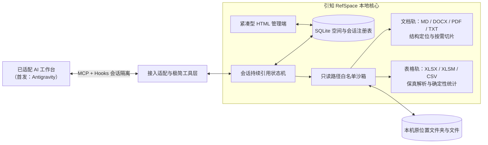

# 引知 RefSpace · 本地资料引用中心

> **关联本机资料，让 AI 持续引用。**  
> *Link once. Keep asking.*

**引知 RefSpace** 是一个面向多 AI 工作台的**本地资料引用中心**。  
它将本机文件夹、表格（`.xlsx` / `.xlsm` / `.csv`）与办公文档（`.md` / `.txt` / `.docx` / `.pdf` / `.json`）组织为命名的**资料空间（Space）**，原件始终保留在电脑原位置维护，无需反复上传或保存整份数据副本；在已接入的 AI 工作台中，**首次按名称引用一次，当前会话即可持续默认沿用，切换范围只需一句话**。

---

## 核心解决的问题

- **告别重复传文件**：每次新开对话、切换任务不必重新翻找目录和上传附件。
- **原件唯一真相源**：文件留在原路径继续日常修改，下次提问前自动检查更新并读取当前版本。
- **多会话严格隔离**：窗口 A 默认引用「杭州仓」，窗口 B 默认引用「客户合同库」，按会话独立记忆、互不串用。
- **文档与表格双轨按需处理**：引用文件夹不等于整包塞入上下文——文档按结构与关键词提取段落，表格在确定范围内执行精确筛选与统计计算，并附带来源依据。

---

## 三个核心概念

| 概念 | 定义 | 示例 |
|---|---|---|
| **资料来源（Source）** | 本机单个文件或文件夹的只读引用 | `/Work/杭州仓/`、`经营月报.xlsx`、`补货SOP.md` |
| **资料空间（Space）** | 具有固定内部 ID、名称与简称的一组资料来源（改名不破坏关联） | `运营资料`（简称：`杭州仓`）、`客户合同库` |
| **会话引用（Session Scope）** | 某个 AI 工作台具体会话当前绑定的资料空间集合 | 会话 `#7176` 默认引用：`杭州仓 + 库存资料` |

---

## 会话持续引用规则

| 用户表达 | 本次任务处理 | 后续会话默认 |
|---|---|---|
| `引用杭州仓` | 绑定「杭州仓」空间到当前会话 | `杭州仓` |
| `分析本月出库与补货情况` | 自动沿用当前空间，按需定位文档与表格计算 | 保持不变 |
| `换成客户合同库` | 替换当前会话引用范围 | `客户合同库` |
| `再加上库存资料` | 在原范围基础上追加空间 | `原空间 + 库存资料` |
| `取消库存资料` | 从当前会话移除该空间 | 其余已引用空间保留 |
| `这次只用客户合同库` | **仅当前单次任务临时使用** | **结束后自动恢复原默认** |
| `取消全部引用` | 清空当前会话引用范围 | 无默认引用 |

- 仅在明确引用意图下切换范围，日常对话提及名称不会误触发切换。
- 名称歧义、来源失联或操作取消时，原子保留原引用范围不变。
- 文件内容严格作为只读数据处理，防止文档内文本篡改会话范围或访问授权。

---

## 系统架构

---

## 开发路线图

- [ ] **阶段 1：首发 AI 接入与会话隔离验证**（打通 Antigravity `Plugin + MCP + Hooks`，实测多窗口 `Conversation ID` 物理隔离与单次临时引用自动恢复）
- [ ] **阶段 2：本地引用核心与只读沙箱**（SQLite 空间注册表、固定 ID 与简称、路径白名单校验、文件移动重新关联）
- [ ] **阶段 3：会话持续引用状态机**（完整实现 7 类引用流转、歧义保护与注入防护）
- [ ] **阶段 4：文档 + 表格双轨按需引擎**（多格式文档段落检索 + Excel/CSV 合并格展开、前导零保真、精确聚合计算与来源溯源）
- [ ] **阶段 5：紧凑型 HTML 管理界面**（资料空间、多类型来源列表、真实连接与可读性状态检测）
- [ ] **阶段 6：Electron 桌面封装与多平台扩展**（原生目录选择、后台常驻生命周期、逐步扩展更多 AI 工作台）

> **当前状态**：项目已完成产品定义、架构蓝图与仓库初始化，正处于 **阶段 1（Antigravity 真实接入与多会话隔离验证）** 开发准备阶段。
